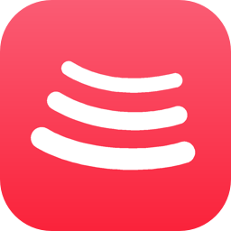
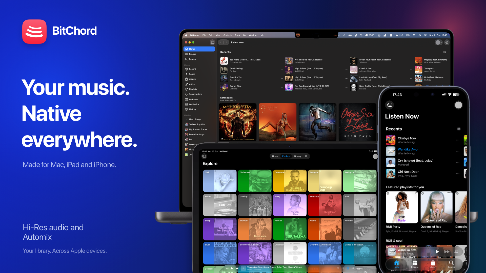

<div align="center">



# BitChord for Apple

**An open-source, native music client for Mac, iPhone and iPad.**<br>
YouTube Music, your own library, DJ-style Automix and Hi-Res playback.

<br>

[](https://github.com/bagumamartin/BitChord/releases/latest)
[](LICENSE)
[](#download)

[](AppleApp)
[](shared)
[](native-core)
[](#download)

**[Download](#download)** · **[Features](#features)** · **[Install](#install)** · **[Build from source](#build-from-source)** · **[Contributing](#contributing)** · **[Disclaimer](#disclaimer--legal-notice)**

<br>



</div>

> [!IMPORTANT]
> This is an unofficial Apple-platform port of [BitChord](https://github.com/kushagrasinghx/BitChord) by [Kushagra Singh](https://github.com/kushagrasinghx). It is not affiliated with, endorsed by, or connected to YouTube or Google in any way. Use it at your own discretion.

## Download

<div align="center">

<a href="https://github.com/bagumamartin/BitChord/releases/latest"></a>&nbsp;&nbsp;
<a href="https://github.com/bagumamartin/BitChord/releases/latest"></a>

<sub><b>Mac:</b> DMG for macOS 15 or later on Apple Silicon, with in-app updates &nbsp;·&nbsp; <b>iPhone & iPad:</b> unsigned IPA for iOS and iPadOS 18 or later</sub>

</div>

Both installers are on the [latest release](https://github.com/bagumamartin/BitChord/releases/latest), alongside `SHA256.txt` and `release.json` with their checksums. Release builds are not signed by a developer or notarized; [Install](#install) shows how to open them. Intel Macs are not supported.

## Features

### Listening
- **YouTube Music** search, browsing and playback, with optional Google sign-in. Accounts with several YouTube channels can switch profiles in Settings.
- **Your own music, too:** configurable sources and source modules, local music files, and WebDAV libraries.
- **Library search** filters your signed-in library and the music on your device as you type, without network requests.
- **Downloads** for offline listening, with per-song progress, and covers kept for offline use.

### Sound
- Choose a preferred quality in **Settings → Sound & Quality → Source Quality**, separately for Wi-Fi and mobile data. **Highest Available** prefers lossless and Hi-Res from enabled sources, with fallback when unavailable. The same page compares the requested quality with the current track's decoded format. Downloads have a separate quality setting under **Downloads & Storage**.
- **Low** limits new streams to 64 kbps and **Medium** to 128 kbps, using known formats within the cap. Already saved files keep their format. **Apply to Current Track** requests a fresh stream at the current position and preserves play/pause intent.
- A native **Rust playback engine** with gapless playback, crossfade, an equalizer, and audio-route information.
- **Lossless** streams when a configured source provides them, and **Dolby Atmos** through Apple's renderer for supported source streams.
- Spatial processing, and on macOS, **bit-perfect output** when the selected DAC and the source format allow it.

### Automix
- **DJ-style transitions** that match tempo, align beats and hand over the bass line from one song to the next.
- Beat and downbeat analysis runs on the **Neural Engine through Core ML**, with optional vocal-clash detection. The models are optional downloads; Automix keeps a fallback without them.

### Lyrics
- Lyrics from several providers, **word-synced** where a source supplies them, with an Apple-style animation.
- Local alignment can add missing word timings using on-device Speech recognition. The lyrics pane explains permission, language/model availability, partial matches and failures; **Retry** can request permission and rerun alignment without replacing the provider's text.

### Made for Apple platforms
- **SwiftUI** on Mac, iPhone and iPad, with the system's adaptable sidebar on iPad, back and forward history, and widgets.
- **In-app updates** on Mac through Sparkle.

### Together
- **Listen Together**, using a compatible server that you supply.
- **Discord Rich Presence**, and **Last.fm** or **ListenBrainz** scrobbling.

Features that depend on external services, sources, audio routes or optional models may behave differently as those dependencies change.

## Install

### Mac

1. Download the DMG from the [latest release](https://github.com/bagumamartin/BitChord/releases/latest), open it, and drag BitChord to Applications.
2. The DMG is ad-hoc signed and not notarized, so Gatekeeper may block the first launch. Open it either way:
   - **System Settings:** go to Privacy & Security, scroll to Security, choose **Open Anyway** for BitChord, then confirm **Open**.
   - **Terminal:**

     ```sh
     xattr -dr com.apple.quarantine "/Applications/BitChord.app"
     open "/Applications/BitChord.app"
     ```

Later versions arrive through **Settings → Version & Updates**, with no need to download the DMG again.

### iPhone and iPad

1. Download the IPA from the [latest release](https://github.com/bagumamartin/BitChord/releases/latest).
2. Sign and install it with [AltStore](https://altstore.io), [SideStore](https://sidestore.io) or [Sideloadly](https://sideloadly.io), using your Apple account or developer team.
3. Trust the developer profile if iOS asks.

To update, sign and install the new IPA over the old one with the same tool and identity. That keeps your data; don't delete the app first.

iCloud sync of lyrics choices and the shared sign-in only work in builds signed with your own team, with the iCloud Key-Value Store and iCloud Keychain capabilities enabled. Otherwise those features use storage on the device.

## Build from source

Builds currently require a Mac with Xcode and the Apple SDKs for the deployment targets above. Install these tools and make them available on `PATH`:

- Xcode, including its command-line tools.
- XcodeGen.
- A JDK supported by the Gradle wrapper.
- Rust with `rustup` and the Apple targets used by the native core.
- CMake, needed by the bundled Opus build.

Clone the repository:

```sh
git clone https://github.com/bagumamartin/BitChord.git
cd BitChord
```

The pinned upstream submodule is kept for source comparison and attribution; it is not a build dependency. Initialize it if you want the upstream source locally:

```sh
git submodule update --init --recursive
```

Build the shared framework and native audio framework, generate the Xcode project, and open it:

```sh
rustup target add aarch64-apple-darwin aarch64-apple-ios aarch64-apple-ios-sim
./scripts/build-shared-framework.sh
./scripts/build-native-core.sh
xcodegen generate --spec AppleApp/project.yml
open AppleApp/BitChord.xcodeproj
```

In Xcode, select the `BitChord` scheme, choose a Mac, iPhone, iPad, or Apple Silicon Simulator destination, then select your Apple Developer Team under the app and widget targets' **Signing & Capabilities**. The Team is per-developer and is not stored in the shared project configuration. For device signing, register and enable the App Group entitlement for both targets with your developer account. The current entitlements are configured for development; review them, including the app sandbox setting, before preparing a distributed macOS build. The generated frameworks, Swift bindings, and Xcode project are build outputs and are ignored by Git.

`build-shared-framework.sh` builds the Debug framework by default. For a Release shared framework, run:

```sh
CONFIG=release ./scripts/build-shared-framework.sh
```

The native-core script builds Release frameworks for the configured Apple targets. Run both framework scripts again after changing code in `shared/` or `native-core/`.

An earlier build installed under a different app identifier remains a separate app; its local data and Keychain session are not migrated. Sign in again in this build, and keep the earlier install if you still need data stored there.

<details>
<summary><b>Optional Listen Together server</b></summary>

<br>

The app does not ship with a hosted Listen Together service. Enter a compatible server in the app, or set `LISTEN_TOGETHER_SERVER` in the environment or in the root `local.properties` file. With neither configured, the listener supplies a server in the app.

</details>

<details>
<summary><b>Optional Automix models</b></summary>

<br>

Automix works without downloaded models, using its built-in tempo and DSP fallbacks. The app offers the beat-and-downbeat model that times transitions, an optional Core ML compilation of that same model for the CPU and Neural Engine, and an optional vocal-clash model; all are downloaded from the project's GitHub releases and verified against a pinned size and SHA-256. The ONNX beat graph stays required as the fallback and for short tracks; the compiled model accelerates the same pass when it is present. No model graph is bundled with the app. The developer helper `scripts/fetch-automix-models.sh` downloads and verifies the two ONNX graphs into `native-core/fixtures/models/`, the cache the native tests and corpus scorecard read.

</details>

<details>
<summary><b>Addon renewal</b></summary>

<br>

Optional [automatic addon renewal](ADDON_REFRESH.md) uses a renewal link supplied by the listener; no addon providers are bundled.

</details>

## Contributing

Bug reports, ideas and pull requests are welcome in [Issues](https://github.com/bagumamartin/BitChord/issues) and [Pull requests](https://github.com/bagumamartin/BitChord/pulls). Please describe the device, OS version and BitChord version and build (shown in **Settings → Version & Updates**).

<div align="center">

**Contributors to this port**

<a href="https://github.com/bagumamartin/BitChord/graphs/contributors"></a>

**And the BitChord contributors this port builds on**

<a href="https://github.com/kushagrasinghx/BitChord/graphs/contributors"></a>

</div>

## Disclaimer & Legal Notice

BitChord is an independent, unofficial third-party music player and client. It is not affiliated with or endorsed by Google LLC, YouTube Music, or the providers of any configured sources.

- **No Media Hosting:** BitChord does not operate a hosted music catalog. It plays local libraries and accesses configured sources and third-party services; downloads are stored on the listener's device.
- **Fair Use & API Usage:** BitChord is created for personal, research, educational and fair-use purposes. It does not grant rights to music or other content. You are responsible for ensuring your use complies with applicable copyright law and the terms of the services and APIs you choose to access, including YouTube and YouTube Music.
- **No Ad-Blocking Guarantee:** BitChord makes no guarantee about the presence, behavior, or availability of advertisements or other platform features. Third-party services can change their access rules and behavior at any time.
- **No warranty and limitation of liability:** For GPLv3-covered portions, the software is provided without warranty and liability is limited as stated in Sections 15 and 16 of [`LICENSE`](LICENSE), except where applicable law requires otherwise or the parties agree in writing. This summary does not replace the license; separately licensed components remain subject to their own terms.
- **Copyleft:** GPLv3 allows redistribution, including for a fee, subject to its terms. Distributors of GPLv3-covered binaries must meet the corresponding-source and notice requirements. Components with additional terms are listed in [`THIRD_PARTY_NOTICES.md`](THIRD_PARTY_NOTICES.md).

## Credits and licenses

Derived from [BitChord](https://github.com/kushagrasinghx/BitChord), Copyright © Kushagra Singh and BitChord contributors, licensed under GPLv3. Apple-platform port and additions Copyright © 2026 Martin BAGUMA, also under GPLv3.

The upstream source is pinned as a Git submodule at [`fe198ac`](https://github.com/kushagrasinghx/BitChord/tree/fe198ac); its source, per-file notices, and license are available in `vendor/bitchord-upstream` when the submodule is initialized. See the upstream repository's [maintainers and contributors](https://github.com/kushagrasinghx/BitChord/blob/fe198ac/MAINTAINERS.md) for upstream attribution.

YouTube stream extraction uses [InnerTubeX](https://github.com/MetrolistGroup/innertubex), the maintained resolver used by current Android upstream. Its source is vendored at revision `a6ca8cb76e9c347d4f21824ca9f19b9db2e5aebd` in `vendor/innertubex`, with its GPLv3 license and notices retained. The Apple adapter adds macOS alongside its iOS targets.

Some analyzer code was ported from [Orchard](https://github.com/SFG5453/Orchard), by SFG545, through BitChord's Android implementation. The relevant files identify SFG545 and Kushagra Singh and retain their AGPLv3-or-later terms. The audio clarity contour also credits the [LastWave-native](https://github.com/Clash-Projects/LastWave-native) reference in its source and notices. The upstream README credits [binimum/am-lyrics](https://github.com/binimum/am-lyrics) for the Apple-like lyrics animation; that credit is preserved here.

## License

The project is licensed under the **GNU General Public License v3.0 (GPLv3)**; see [`LICENSE`](LICENSE). Some files and bundled dependencies carry additional or separate terms. Read [`THIRD_PARTY_NOTICES.md`](THIRD_PARTY_NOTICES.md), the license texts in `LICENSES/` and `AppleApp/Resources/AudioLicenses/`, and individual source headers before redistributing or modifying those components. In the app, see **Settings → About → Open-source licenses**.

Binary releases: every GitHub release is built from its tagged commit, and that tag's source archive is the Corresponding Source (GPLv3 §6).
